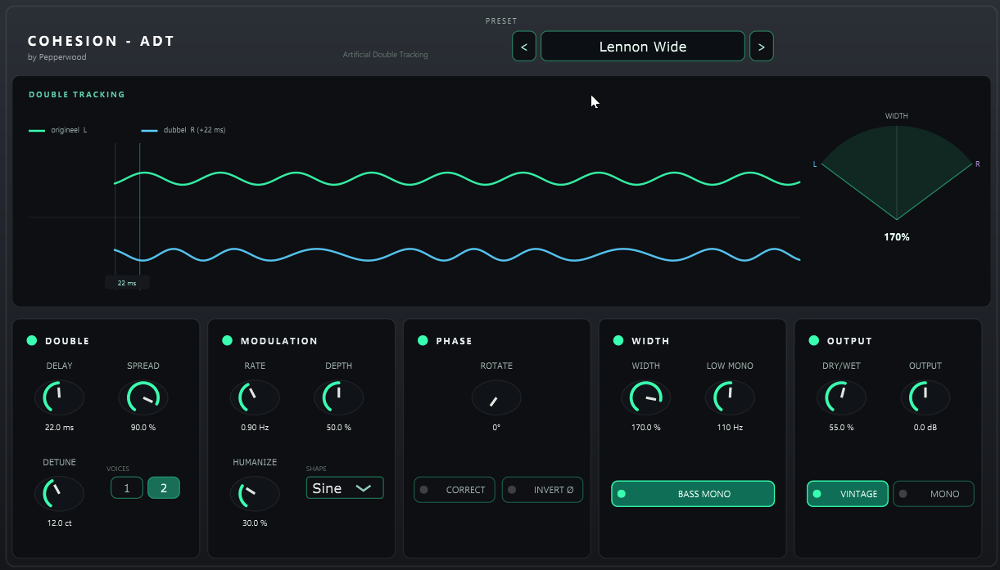

# COHESION — ADT

Original JUCE/VST3 plugin by **Pepperwood** — part of the [COHESION](../README.md) suite.

**Artificial Double Tracking (ADT)** recreates the Abbey Road studio trick: the signal is
doubled with a short modulated delay so a single vocal sounds thicker and wider.

## Features

- **Double** — delay (5–40 ms), 1 or 2 voices, SPREAD (timing difference / thickness),
  DETUNE.
- **Modulation** — LFO rate, depth and humanize (sine or random) for the subtle
  pitch-wobble that makes the double feel like a second take.
- **Phase** — all-pass ROTATE, CORRECT and polarity INVERT.
- **Width** — separates the original and the double, from centred (thickening) at 0 %
  to hard left/right at 100 %, with BASS MONO to keep the low end centred.
- **Output** — Dry/Wet, output gain, Vintage (gentle high-cut + saturation), Mono.
- A live, flowing before/after waveform display and a set of factory presets named
  after famous double-tracked vocals.



## Build

```bash
cmake -S . -B build
cmake --build build --config Release
```

JUCE 7.0.12 is fetched automatically (or reused from a sibling Cohesion project).

## License

© Pepperwood. All rights reserved.
