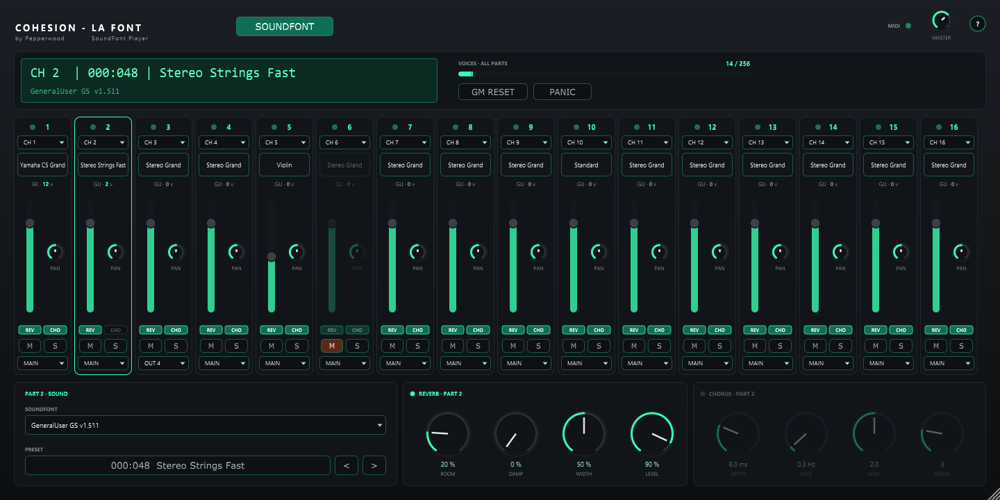

# COHESION — LA FONT

JUCE/VST3 instrument by **Pepperwood** — part of the [COHESION](../README.md) suite.

A multi-timbral **SoundFont player**: 16 parts on their own MIDI channels, each with its own
SoundFont (.sf2), preset, reverb, chorus, mixer channel and output. Plays standard MIDI files
like a GM / GS module. No SoundFonts are included: add your own.



## Engine: FluidSynth

The sound comes from [FluidSynth](https://github.com/FluidSynth/fluidsynth) (GNU LGPL 2.1+).
FluidSynth is *not* part of this plugin's code: it ships as the separate `libfluidsynth-3.dll`
next to the plugin binary (with its licence text) and is loaded at run time. One FluidSynth
synth plays all 16 parts with 16 output pairs and 16 effect groups, so every part has its own
reverb / chorus and its own output.

A SoundFont is loaded on a background thread first (FluidSynth keeps samples in a process-wide
cache), then attached to the synth: loading a 1 GB SoundFont never blocks the audio, and plugin
instances share the sample data.

## Features

- **SOUNDFONT** menu: add SoundFont files or a whole folder to the list (files are referenced,
  never copied), use one SoundFont for all parts, remove one from the list, show its folder.
  The list lives in `%APPDATA%\Pepperwood\Cohesion LA Font\soundfonts.txt`. SF2 only (SF3 /
  compressed SoundFonts are not supported).
- **16 parts** on MIDI channels 1–16 (selectable per part, OFF / 1–16); part 10 plays the drum
  kits (bank 128). Program changes, bank select (GS variations), controllers and GM / GS / XG
  reset messages as on a GM module.
- **LCD** `CH | bank:program | name` plus the part's SoundFont; **VOICES** of all parts with a bar
  per part; GM RESET and PANIC.
- **Strips**: preset name (click for the preset list), SoundFont tag and voices, fader, pan,
  REV / CHO state, mute / solo (dimmed), output MAIN or OUT 2–17.
- **SOUND / REVERB / CHORUS** boxes for the selected part: SoundFont and preset (with ‹ ›),
  FluidSynth reverb (room, damp, width, level) and chorus (depth, rate, level, voices), each with
  an on / off switch in its title. Send levels come from MIDI CC 91 / 93.
- **(?)**: short manual, credits and disclaimer. Resizable (60–200 %).

## Build

```bash
git clone --depth 1 https://github.com/FluidSynth/fluidsynth.git ../_ref/fluidsynth
cmake -S . -B build
cmake --build build --config Release
```

FluidSynth is built without audio / MIDI drivers or extra libraries (C++11 OS layer, no GLib).

Offline test (loading, 16 parts, drums, bank select, multi-out, effects, GM reset, state, UI):

```bash
cmake -S tests -B build-tests
cmake --build build-tests --config Release
build-tests/FontTest_artefacts/Release/FontTest.exe "<folder with .sf2 files>" "<output folder>"
```

## License

© Pepperwood. All rights reserved. `libfluidsynth-3.dll` is FluidSynth, licensed under the GNU
LGPL 2.1 or later (see `fluidsynth-LICENSE.txt` in the plugin folder). SoundFont is a registered
trademark of Creative Technology Ltd.; this product is not affiliated with Creative.
