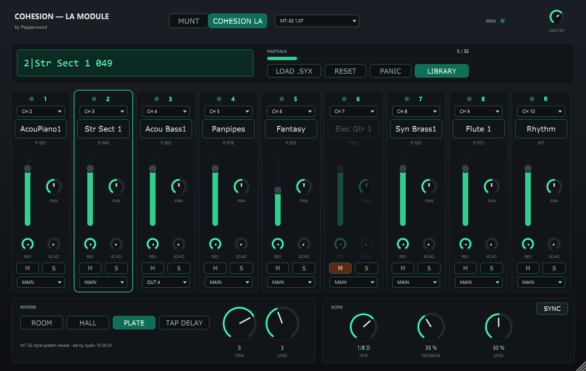

# COHESION — LA MODULE

JUCE/VST3 instrument by **Pepperwood** — part of the [COHESION](../README.md) suite.

A multi-timbral **MT-32 / CM-32L sound module**: eight melodic parts plus a rhythm part, each
on its own MIDI channel, with its own MT-32 reverb and echo, a mixer and separate outputs per
part. It plays your own Roland control + PCM ROM dumps (never included).



## Engine: Munt

The sound comes from [Munt](https://github.com/munt/munt) (mt32emu, LGPL 2.1+). Munt is *not*
part of this plugin's code: it ships as a separate `mt32emu.dll` next to the plugin binary
(with its licence text) and is loaded at run time. Every part runs in its own Munt instance,
which gives each part its own output and its own reverb (each part has 32 partials of its own).

## Features

- **LIBRARY** reads your ROMs from a folder (the .zip files in it are scanned too); the picker
  next to it chooses the ROM set. Sets are shared with COHESION — SYNTH
  (`%APPDATA%\Pepperwood\Cohesion Synth\ROMs`). Without a set the LCD says NO ROM LOADED.
- **Parts 1–8 + rhythm** on MIDI channels 2–9 and 10 by default; each part's channel is
  selectable (OFF / 1–16). Program changes, controllers and **MT-32 SysEx** (timbres, patches,
  rhythm setup, system area, reset) as on the hardware. **LOAD .SYX** sends a SysEx file.
- **LCD** `CH | program | name` of the selected part, partial meter, RESET and PANIC. A click on
  a part's name picks a timbre from group A / B.
- **Mixer** per part: level, pan, mute / solo (muted parts dim), output MAIN or the part's own
  stereo output (OUT 2–10, enable the extra outputs in the DAW).
- **Reverb and echo per part**: the boxes at the bottom edit the selected part — MT-32 reverb
  (Room / Hall / Plate / Tap Delay, time, level) and a tempo-synced echo, each with an on / off
  switch in its title. An MT-32 system-reverb SysEx sets the reverb of every part. A part's
  reverb and echo go to the same output as the part.
- **(?)** top right: short manual, credits (Munt / LGPL, JUCE) and the trademark disclaimer.
- Resizable (60–200 %); size and the full MT-32 memory are saved with the project.

## Build

```bash
cmake -S . -B build
cmake --build build --config Release
```

Munt's source must be in `../_ref/munt` (outside git) to build `mt32emu.dll`:

```bash
git clone --depth 1 https://github.com/munt/munt.git ../_ref/munt
```

Offline test (all parts, per-part reverb / echo, SysEx, routing, state, UI snapshots):

```bash
cmake -S tests -B build-tests
cmake --build build-tests --config Release
build-tests/ModuleTest_artefacts/Release/ModuleTest.exe "<folder with ROMs>" "<output folder>"
```

## License

© Pepperwood. All rights reserved. `mt32emu.dll` is Munt, licensed under the GNU LGPL 2.1 or
later (see `mt32emu-COPYING.LESSER.txt` in the plugin folder and https://github.com/munt/munt).
