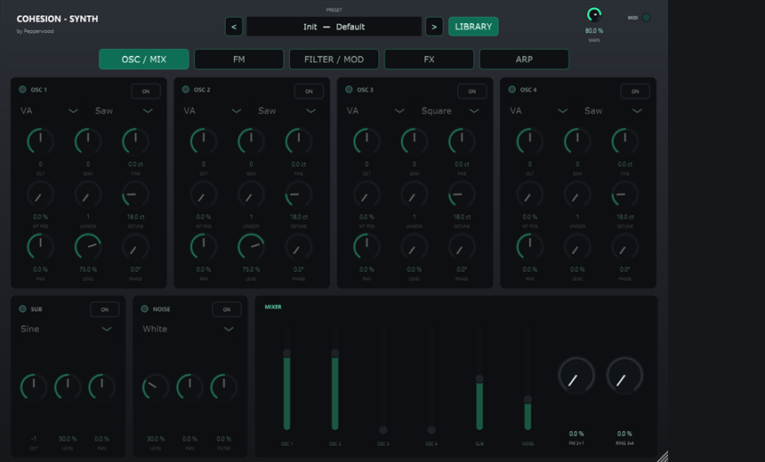
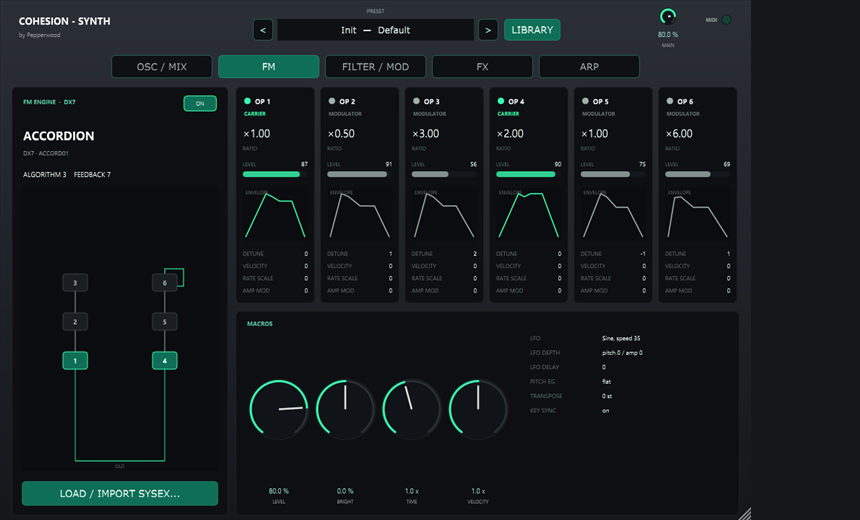
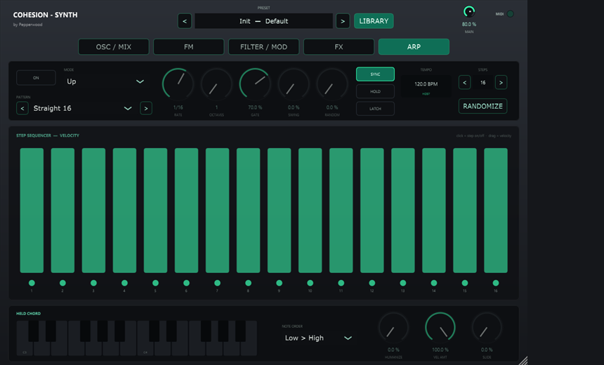

# COHESION — SYNTH

Original JUCE/VST3 instrument by **Pepperwood** — part of the [COHESION](../README.md) suite.

A polyphonic hybrid synthesizer: four virtual-analog oscillators plus a **DX7-compatible
6-operator FM engine** and an **MT-32 / CM-32L-compatible LA engine**, two filters, a modulation matrix, an FX chain and a programmable
arpeggiator, in the Cohesion house style. All DSP is original code.



## Sound sources — OSC / MIX and FM

- **4 oscillators** (band-limited saw / square / triangle / sine) with unison & detune,
  octave / semitone / fine, pan, level and phase; **SUB** and **NOISE** (white / pink);
  **FM 2 → 1** and **ring 3 × 4**; a mixer with faders per source.
- **FM engine (DX7-compatible)**: 6 operators, all 32 algorithms, 4-rate / 4-level operator
  envelopes, ratio or fixed frequency, detune, feedback, velocity and keyboard scaling,
  pitch EG and LFO. Macros: level, brightness, envelope time and velocity.



- **LA engine (MT-32 / CM-32L-compatible)**: plays the timbres of your own Roland control + PCM
  ROM dumps (never included) — up to 4 partials per timbre (square/saw with pulse width and a
  resonant filter, or PCM samples from the ROM), pitch envelope and LFO, amp envelope and the
  13 partial-pair structures including ring modulation. Macros: level, cutoff, envelope time.
  **IMPORT ROMS** scans a folder (and the .zip files in it), pairs control and PCM ROMs,
  skips versions with identical sound and lists each set as `<set> · A / B / Rhythm`.

## FILTER / MOD

Ladder filter (LP 24 / LP 12 / HP) and a state-variable filter (LP / HP / BP / notch,
12 / 24 dB) in series or parallel; four ADSR envelopes, four LFOs and an 8-slot mod matrix
(LFO / envelope / velocity / mod wheel / key track → cutoff, pitch, amp, pan, LFO rate).

## FX

Compressor, flanger, phaser, echo (ping-pong, tempo sync) and an 8-line FDN reverb in a
**drag-and-drop signal chain**, followed by a lookahead limiter. Effects switch on and off
without clicks.

## ARP

Arpeggiator with a 16-step velocity sequencer: up / down / up-down / down-up / random /
chord, 1–4 octaves, rate with triplets, gate, swing, random, humanize, slide, hold & latch,
host-grid sync or free tempo, and 16 step patterns.



## Presets and DX7 SysEx

- **1,101 factory presets**: 100 per category (Arp, Bass, Drums, Flute, FX, Keys, Lead, Pad,
  Pluck, Strings, Synth) plus Init. Every preset was rendered offline and loudness-matched.
- **LIBRARY** browser with categories and presets.
- **IMPORT .SYX / IMPORT FOLDER** loads Yamaha DX7 banks (32-voice bulk dumps and single
  voices). Banks are kept in `%APPDATA%\Pepperwood\Cohesion Synth\SysEx` and appear as
  `DX7 · <bank>` categories; blank slots and duplicates are skipped.
- New DX7 banks can be assembled with [COHESION — SYSEX](../Cohesion-SysEx/README.md).

The editor is resizable (60–200 %, fixed aspect ratio) and remembers its size.

## Build

```bash
cmake -S . -B build
cmake --build build --config Release
```

Offline tests (FX, arpeggiator, FM engine, presets, loudness, UI snapshots):

```bash
cmake -S tests -B build-tests
cmake --build build-tests --config Release
```

## License

© Pepperwood. All rights reserved.
