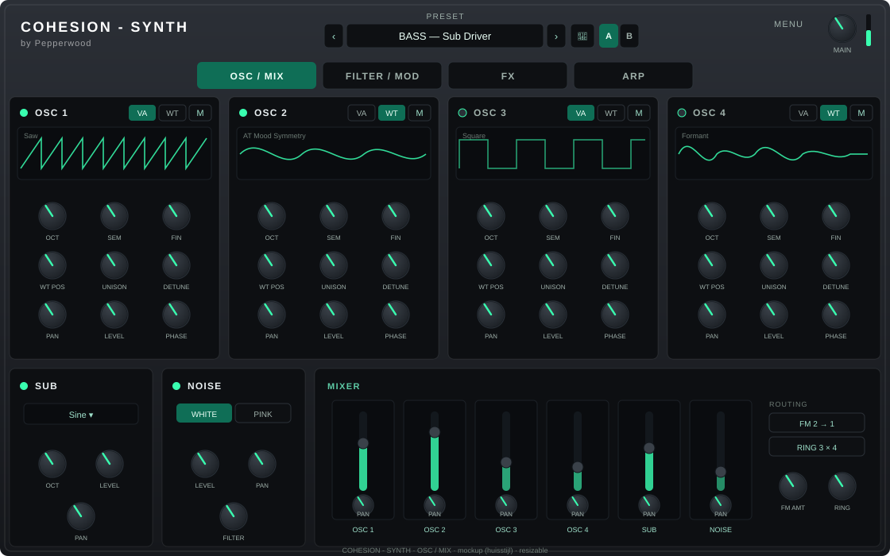

# COHESION — SYNTH

Part of the [COHESION](../README.md) suite by **Pepperwood** — **design stage**.

A planned 4-oscillator synthesizer (hybrid virtual-analog + wavetable), dual ZDF filters,
LFOs and envelopes, a modulation matrix, an FX chain (reverb / echo / comp / phaser /
flanger + master limiter) and a programmable arpeggiator — all in the Cohesion house style.

Only the approved GUI mockups exist so far (no DSP yet):

- `mockups/01-osc-mix.svg` — oscillators + mixer
- `mockups/02-filter-mod.svg` — filters + modulation matrix
- `mockups/03-fx.svg` — FX chain
- `mockups/04-arp.svg` — arpeggiator

