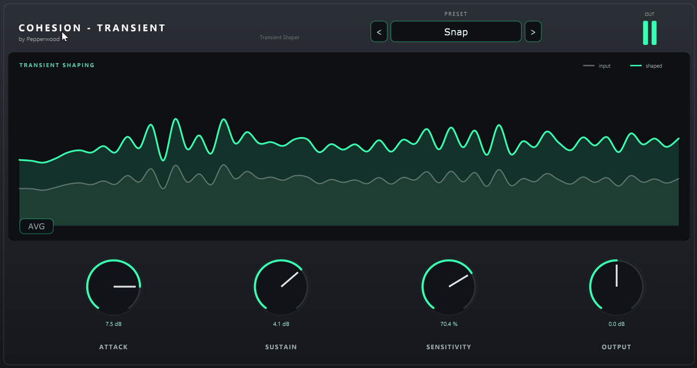

# COHESION — TRANSIENT

Original JUCE/VST3 plugin by **Pepperwood** — part of the [COHESION](../README.md) suite.

A focused **transient shaper** with just four controls. It reshapes the dynamics of a
sound — adding punch and snap or softening the attack, tightening or lengthening the body —
without touching the overall tone.

## Controls

- **ATTACK** (±12 dB) — boost or cut the attack / punch of each onset.
- **SUSTAIN** (±12 dB) — boost or cut the body / tail.
- **SENSITIVITY** (0–100 %) — how strongly the transient detector reacts.
- **OUTPUT** (±24 dB) — makeup / final level, with a transparent soft-clip.

## How it works

A differential-envelope detector (SPL-style): two peak-hold envelope pairs track the
level — a fast-vs-slow **attack** pair marks the onset, a fast-vs-slow **release** pair
marks the tail. Both detection signals are ≥ 0, so in steady state the gain is exactly
0 dB (no pumping). Detection is **stereo-linked** (the same gain on L and R, so the stereo
image stays intact) and the whole path is **zero-latency**. A live, rounded display shows
the input (grey) vs the shaped result (teal), with an **AVG** button for a calmer averaged
view. Eight factory presets are included (Punch Up, Snap, Soften, Tame, Fat, Drum Smack,
Room Kill, Flat).



## Build

```bash
cmake -S . -B build
cmake --build build --config Release
```

JUCE 7.0.12 is fetched automatically (or reused from a sibling Cohesion project).

## License

© Pepperwood. All rights reserved.
