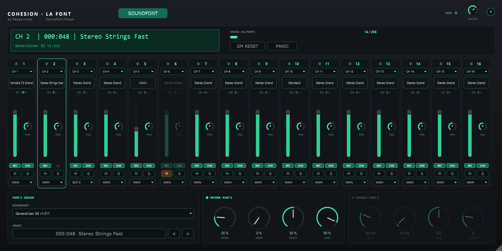
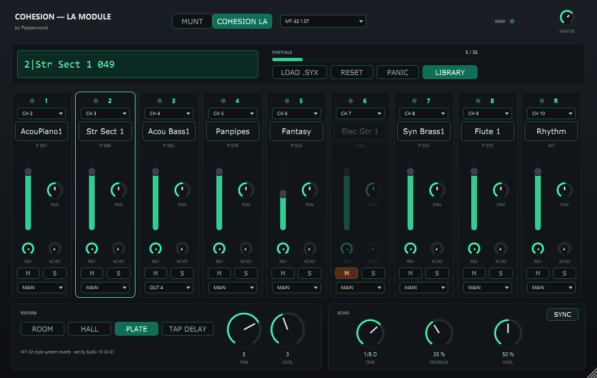

# COHESION

**COHESION** is a suite of original JUCE audio tools by **Pepperwood** — four VST3 effects,
a VST3 synthesizer, an MT-32-compatible sound module, a SoundFont player and a standalone DX7 bank builder — sharing
one dark/teal house style and a consistent workflow. All DSP is original code (the sound engines of
LA MODULE and LA FONT are the separate, LGPL-licensed Munt and FluidSynth libraries).

| Plugin | What it does |
|--------|--------------|
| **COHESION — GLUE** | Master-bus "glue" compressor for cohesion on the mix bus. |
| **COHESION — EQ/COMP** | Parametric EQ (TPT/ZDF) + flexible multiband dynamics + brick-wall limiter, with an **ASSIST** engine that listens to the signal and proposes EQ/comp settings per instrument & style. |
| **COHESION — ADT** | **Artificial Double Tracking** — the Abbey Road trick: a modulated, delayed double of a vocal to make it thicker and wider. |
| **COHESION — TRANSIENT** | Four-control transient shaper (attack, sustain, sensitivity, output) — add punch or soften attacks. |
| **COHESION — SYNTH** | Polyphonic hybrid synth: 4 VA oscillators + a DX7-compatible 6-operator FM engine, 2 filters, mod matrix, FX chain, arpeggiator, wavetables, 1,229 presets (incl. a General MIDI bank) and DX7 SysEx import. |
| **COHESION — LA FONT** | SoundFont player (FluidSynth): 16 parts on their own MIDI channels, a SoundFont and preset per part, reverb and chorus per part, mixer and separate outputs. |
| **COHESION — LA MODULE** | MT-32 emulator (Munt): 8 parts + rhythm on their own MIDI channels, MT-32 SysEx, reverb and echo per part, mixer and separate outputs. |
| **COHESION — SYSEX** | Standalone app that builds new DX7 32-voice SysEx banks from voices picked out of a `.syx` collection. |

## Plugins

### COHESION — SYNTH
A polyphonic hybrid instrument: four virtual-analog oscillators, sub and noise, plus a
**DX7-compatible 6-operator FM engine** (all 32 algorithms); ladder + state-variable filters,
four envelopes, four LFOs and an 8-slot mod matrix; a drag-and-drop FX chain (comp, flanger,
phaser, echo, reverb) with a limiter; and an arpeggiator with a 16-step velocity sequencer.
1,229 loudness-matched factory presets (incl. the 128 General MIDI programs) in a searchable LIBRARY browser, and DX7 SysEx banks can be
imported. See [Cohesion-Synth](Cohesion-Synth/README.md).


### COHESION — LA FONT
A multi-timbral SoundFont player for your own .sf2 files, built on FluidSynth (loaded as a
separate LGPL DLL): 16 parts on their own MIDI channels, each with its own SoundFont, preset,
reverb and chorus, a mixer (level, pan, mute / solo) and a separate stereo output per part; plays
standard MIDI files like a GM / GS module. See [Cohesion-LaFont](Cohesion-LaFont/README.md).



### COHESION — LA MODULE
An MT-32 / CM-32L emulator for your own Roland ROM dumps, built on Munt (loaded as a separate
LGPL DLL): eight melodic parts and a rhythm part, each with its own MIDI channel, program
changes and MT-32 SysEx, its own MT-32 reverb and echo, a mixer (level, pan, mute / solo) and a
separate stereo output per part. See [Cohesion-LaModule](Cohesion-LaModule/README.md).



### COHESION — SYSEX
Standalone DX7 bank builder: index a `.syx` collection, search and audition voices through
the FM engine, drag up to 32 voices into a bank and export a standard bulk dump that loads
on a DX7, Dexed or MiniDexed. See [Cohesion-SysEx](Cohesion-SysEx/README.md).


### COHESION — ADT
Artificial Double Tracking: a short modulated delay (≈15–35 ms, no feedback) with subtle
LFO pitch-wobble, phase controls, and a WIDTH that separates the original and the double
from centred (thickening) to hard left/right. Factory presets named after classic
double-tracked vocals (Lennon Wide, Abbey Road '66, Tomorrow Never…, Elliott Smith, …).


### COHESION — TRANSIENT
A four-control transient shaper using a differential-envelope detector: **Attack** and
**Sustain** (±dB) reshape the onset and the body, **Sensitivity** sets how strongly the
detector reacts, and **Output** is makeup. Stereo-linked, zero-latency, with a live
rounded input-vs-shaped display and factory presets (Punch Up, Snap, Soften, Drum Smack, …).


### COHESION — EQ/COMP
6-band parametric EQ + HPF/LPF, 2–5 band multiband dynamics, output limiter, live
before/after spectrum, and the ASSIST analysis engine.


### COHESION — GLUE
Master-bus glue compressor (the first plugin of the suite).


## Repository layout

```
COHESION/
├─ Cohesion-Glue/     # COHESION - GLUE      (VST3 "Cohesion Glue")
├─ Cohesion-EQComp/   # COHESION - EQ/COMP   (VST3 "Cohesion EQ-Comp")
├─ Cohesion-ADT/       # COHESION - ADT       (VST3 "Cohesion ADT")
├─ Cohesion-Transient/ # COHESION - TRANSIENT (VST3 "Cohesion Transient")
├─ Cohesion-Synth/     # COHESION - SYNTH     (VST3 instrument "Cohesion Synth")
├─ Cohesion-LaModule/  # COHESION - LA MODULE (VST3 instrument "Cohesion LA Module")
├─ Cohesion-LaFont/    # COHESION - LA FONT   (VST3 instrument "Cohesion LA Font")
├─ Cohesion-SysEx/     # COHESION - SYSEX     (standalone DX7 bank builder, see its README)
├─ Common/            # shared by every app: version helpers (CMake) + start-up update check
├─ versions.json      # the version of every app (single source of truth)
└─ installer/         # Inno Setup script for the combined Windows installer
```

## Build

Each plugin builds on its own with CMake; JUCE 7.0.12 is fetched automatically on the
first configure (one plugin's fetched JUCE is reused by the others, so build one first).

```bash
cmake -S . -B build
cmake --build build --config Release
```

Run this inside a project folder (e.g. `Cohesion-ADT`). A built `.vst3` lands in
`build/<Target>_artefacts/Release/VST3/`; on Windows, copy it to
`C:\Program Files\Common Files\VST3\`. COHESION — SYSEX builds a standalone app.

## Versions and the update check

Every app has its own version in [`versions.json`](versions.json) (`"apps": { "synth": "1.4.0", … }`).
CMake reads it at configure time (`Common/CohesionVersion.cmake`), so it ends up in the plugin's
ProjectInfo and in the Windows file version of the `.vst3` / `.exe`.

When an app's window opens, it fetches `versions.json` from this repository's `master` branch on
GitHub in the background. If its own entry there is newer than the version it was built with,
the header shows **UPDATE AVAILABLE**; hovering names the new version, clicking opens the
releases page. Offline or on any error nothing is shown and nothing waits.

To release a new version of one app: bump its entry in `versions.json`, rebuild that app, push.

Testing: configure with `-DCOHESION_VERSION_OVERRIDE=1.0.0` to build an app that pretends to be
older; `COHESION_UPDATE_URL=<file or URL>` points the check at another `versions.json`, and
`COHESION_UPDATE_CHECK=0` switches it off.

## Installer

A combined, branded Windows installer is built from `installer/Cohesion.iss` with
Inno Setup 6 (`ISCC.exe installer/Cohesion.iss`). It lets you choose which plugin(s) and apps
to install and the plugin location (defaults to the VST3 folder); COHESION — SYSEX goes to
`Program Files\Pepperwood` with a Start-menu shortcut. Download the latest pre-built
installer from the [releases](../../releases/latest).

The installer reads the version each component carries from its built binary and compares it
with the one already installed in the chosen folder: a component that is already at that
version (or newer) is greyed out and marked *up to date*; the others show *new* or
*update vX → vY*.

## License

© Pepperwood. All rights reserved. The `mt32emu.dll` shipped with COHESION — LA MODULE
is [Munt](https://github.com/munt/munt) and the `libfluidsynth-3.dll` shipped with COHESION — LA FONT is
[FluidSynth](https://github.com/FluidSynth/fluidsynth), both licensed under the GNU LGPL 2.1 or later.
